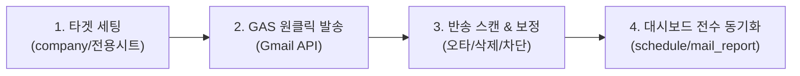
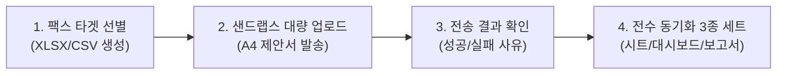

# 📋 대흥정밀 B2B 아웃바운드 정기 로테이션 표준운영절차 (SOP)

> **문서 목적:** 매주 월요일 반복되는 이메일 및 팩스 아웃바운드 영업 집행, 구글 시트 적재, 대시보드 및 보고서 동기화 전 과정을 표준화하여 운영 누락을 방지하고 원클릭 자동화를 지원합니다.

---

## 📅 1. 월간 4주 로테이션 주기표

| 주차 | 주기 | 채널 | 대상 타겟군 | 표준 발송 규모 | 핵심 목표 |
|:---:|:---:|:---:|:---|:---:|:---|
| **1주차** | 매월 1주 월요일 | **📧 이메일** | 기존 검증 성공군 | 70개사 내외 | 2차/정기 리마인드 제안서 발송 |
| **2주차** | 매월 2주 월요일 | **📠 팩스** | 기존 검증 팩스군 | 30개사 내외 | 샌드랩스 대량 웹팩스 A4 제안서 발송 |
| **3주차** | 매월 3주 월요일 | **🔄 복합** | 신규 크롤링 + 재검증 | 50~70개사 | 전국 20개 지역 신규 리드 수집 및 보강 |
| **4주차** | 매월 4주 월요일 | **📧+📠** | 신규+검증 복합군 | 100개사+ | 월말 총결산 하이브리드 대량 아웃바운드 |

---

## 📧 2. 이메일 발송 표준 프로세스 (4단계)



### [STEP 1] 발송 타겟 추출 및 세팅
- 대상: `company` 시트에서 유효 이메일이 있고 과거 성공 이력이 있는 우량 타겟.
- 조치: 해당일 전용 시트(예: `2026-11-09`) 생성 후, A열 체크박스 `TRUE` 및 M열 `2차 정기(월/일)` 자동 입력.

### [STEP 2] Gmail API 일괄 발송
- 구글 스프레드시트 상단 맞춤 메뉴: `[대흥 아웃바운드]` ➔ `[선택 제안서 발송 (v1/v2 자동분기)]` 클릭.
- 자동으로 업체별 맞춤 템플릿(신규: v1, 기존: v2) 분기 발송 및 `mail_log` 실시간 적재.

### [STEP 3] 실시간 반송(Bounce) 분석 및 시트 보정
- 수신함 Mailer-Daemon 알림 즉시 확인:
  1. **도메인 오타** (예: `.co` ➔ `.co.kr`): 즉시 주소 수정 및 `재시도대기` 설정.
  2. **계정 삭제/탈퇴**: `실패(계정삭제)` 표기 및 향후 발송 제외.
  3. **수신 보안 차단**: `실패(수신차단)` 표기 및 영업채널 **팩스**로 즉시 전환.

### [STEP 4] 로그 및 대시보드 동기화
- `mail_log` 시트 내 반송 건 상태를 `실패`로 보정.
- 실행 스크립트:
  ```powershell
  python workflow/build_schedule_dashboard.py
  ```
- 결과: `schedule` 시트, `mail_report.html`에 성공/실패 수치 100% 일치 반영.

---

## 📠 3. 팩스 발송 표준 프로세스 (4단계)



### [STEP 1] 샌드랩스용 타겟 추출
- 대상: 유효 팩스번호 보유 업체 중 성공 이력사 및 메일 차단 전환 업체 (약 30개사).
- 산출물: `sales/fax/fax_targets_YYYYMMDD.xlsx` 및 `.csv` 자동 생성.
- 구글시트 연동: 당일 전용 시트(예: `2026-11-16`) 신설 및 회차 표기.

### [STEP 2] 샌드랩스 대량 발송 집행
1. [샌드랩스(Sendlabs)](https://www.sendlabs.co.kr/main.do) 로그인 ➔ `[대량 팩스 발송]` 이동.
2. `[엑셀 대량 등록]` 클릭 후 생성된 `fax_targets_YYYYMMDD.xlsx` 업로드.
3. A4 제안서 첨부 후 발송 완료 (건당 25 Cash 소진).

### [STEP 3] 발송 결과 동기화 스크립트 실행
- 발송 완료 화면의 번호별 결과(성공/실패)를 기반으로 아래 통합 동기화 스크립트 실행:
  ```powershell
  python sales/sync_fax_results_YYYYMMDD.py
  ```
- **자동 처리 내역**:
  - `fax_log` 시트: 29~30건 전수 이력 누적 적재
  - `company` 시트: N열(팩스 성공), O열(발송일시), Q열(수신결과) 배치 업데이트
  - `schedule` 시트: 주간/월간 팩스 성공률 실시간 갱신

### [STEP 4] 대시보드 및 웹 보고서 전수 갱신 (★필수 체크리스트★)
누락 방지를 위해 아래 3개 채널이 반드시 동시에 업데이트되어야 합니다:
- [x] **1. 통합 관리자 대시보드**: `dashboard.html` (`defaultFaxData` 주입 및 `FAX_CACHE_VERSION` 갱신)
- [x] **2. 웹 팩스 보고서**: `fax/fax_report.html` (`allFaxLogs` 주입 및 드롭다운 최신 회차 자동 선택)
- [x] **3. 결과 워드 보고서**: `sales/fax/YYYY-MM-DD_fax_result_batchX.docx` 생성 (맑은 고딕, 10pt)

---

## 🛠️ 4. 필수 파일 및 디렉터리 맵

| 구분 | 경로 | 역할 |
|---|---|---|
| **마스터 플랜** | `plan/dhsteel_plan_2026.html` | 종합 로드맵 및 단계별 WBS 체크리스트 |
| **통합 대시보드** | `dashboard.html` | 이메일 & 팩스 듀얼 모니터링 관리자 웹 |
| **팩스 웹 보고서** | `fax/fax_report.html` | 회차별 팩스 수신 결과 상세 보고서 웹 |
| **메일 웹 보고서** | `mailling/mail_report.html` | 회차별 메일 수신/반송 상세 보고서 웹 |
| **스프레드시트** | 구글 시트 ID: `1kEdvR2h...` | `company`, `schedule`, `mail_log`, `fax_log` |

